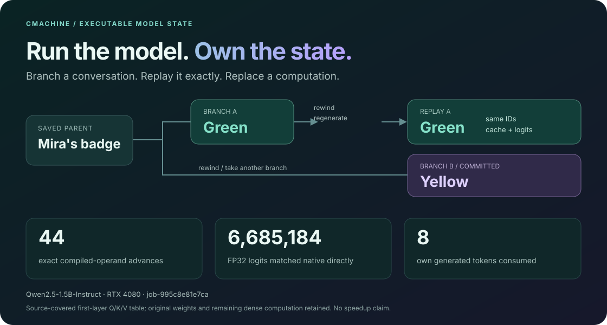

# cmachine

An explicit C model state machine for executing, inspecting and replacing neural computations.

C owns the live state, the model equations, output selection and continuation. The prototype supports the R3 direct-effect ISA Mamba specimen on CPU and Qwen2.5-1.5B-Instruct through C, CUDA and cuBLAS. An [operator-driven intake path](research/model_intake/README.md) also compiles PAN and canonical Mamba1 graphs to CPU C programs with generated source maps. Python handles offline exports, optional tokenization and research analysis; it is outside the numerical serving executor.

The goal is to turn understood computations into executable programs that can form their own operands, update consequential state and continue at lower cost. The current Qwen implementation still evaluates the dense model. Avoiding a framework `forward()` call does not remove that computation.

**See it work:** [interactive demo showcase](demos/showcase.html) · [runnable demos and results](demos/README.md). Start with `python3 demos/run.py tour` for a weight-free tour of state, replay, operand programs and a nonlinear closure/repair experiment.

[](demos/README.md)

This is now the canonical working repository. The complete former `saturn/cmachine` research tree lives under [research/](research/README.md), including its local raw evidence. A compatibility link preserves the old workspace address. Research `src`, `tests`, `tools` and `Makefile` resolve to this repository's canonical runtime. Large raw/model archives remain local and ignored by Git; research sources, protocols and findings are tracked here.

The [integrated runtime](docs/INTEGRATED-RUNTIME.md) adds all-layer byte caches, bounded anchors/recent/reservoir retention, overwritten-row recovery, source-BF16 weight tiling and persistent bounded chat to the existing writer/lineage core. Native remains the default. [Commit verification](validation/README.md) builds exact Git objects, compares the original and integrated native cores, and authenticates historical compressed-cache behavior through a guarded Beast lease.

**Verified integration:** source commit `7a6824dd9b640cfa785fa56cc4e7cfae14193f1c` passed guarded Beast job `job-f645fcd76a75`. The [tracked proof bundle](docs/evidence/integration-7a6824d/README.md) contains the exact executed sources, raw results and receipts, with an offline verifier. All 84 native/reference protocol entries agree, compressed profiles reproduce historical behavior, and real overwrite/abort/retry checks pass. The tested build is installed at `/mnt/big/cmachine/current`; bounded delayed-recall failures remain.

- [Architecture and state contracts](docs/ARCHITECTURE.md)
- [Supported models, numerical profiles and measured logit error](docs/SUPPORTED-MODELS.md)
- [Supported capabilities and model computations](docs/CAPABILITIES.md)
- [Vision, simplifying assumption and research gaps](docs/VISION.md)
- [Current evidence and limitations](docs/STATUS.md)
- [Explicit query programs, lexical tables and compact-reader pullbacks](docs/QUERY-PROGRAMS.md)
- [Import provenance](docs/PROVENANCE.md)
- [Optional Saturn/mrun integration](docs/INTEGRATION.md)
- [Automated model intake, C programs and execution evidence](research/model_intake/README.md)

## Supported models

| Tested model profile | C execution | Measured source/C comparison |
| --- | --- | --- |
| R3 direct-effect ISA Mamba | CPU FP32 C/libm; architectural instruction commits | 16 matching commits; maximum head-value error `6.10e-5`. |
| Qwen2.5-1.5B-Instruct | FP32 C/CUDA/cuBLAS; persistent chat and owned K/V | Three matching own-token trajectories against native FP32; maximum first-readout logit error about `2.67e-4`. |
| PAN P113 seed 0 | CPU FP32; trusted FX graph compiled to `tcm program` | All 12,769 predictions match; maximum absolute logit error `9.15527e-5`. |
| MambaSan-130m-instruct | CPU FP32/OpenBLAS; canonical Mamba1 graph compiled to `tcm program` | All 18 generated tokens match across two Japanese prompts; maximum absolute logit error `1.43051e-5`; exact C suffix replay. |

These are bounded comparisons for the recorded checkpoints, inputs and numerical profiles. The [model reference](docs/SUPPORTED-MODELS.md) gives import routes, mean and maximum logit errors, evidence and limits. PAN accuracy remains 57.8119%, and the instruction Mamba answers both tested questions incorrectly. Execution fidelity and answer quality are separate results.

## What works

| Surface | Implemented behavior |
| --- | --- |
| Qwen execution | Incremental token ingestion, full attention/SwiGLU/readout, greedy selection and persistent all-layer K/V. |
| Conversation state | Pending versus consumed token ownership, exact token-prefix reuse and explicit reset on a changed prefix. |
| Continuations | Session-local checkpoints and up to 64 nested token-boundary parents with rollback, commit and parent-lineage checks. |
| Compressed memory | Full-byte or fixed anchors/recent/reservoir support, immediate encoded append/read, two complete snapshot-backed parents and token-abort recovery. |
| Weight residence | Explicit native FP32, tiled FP32 and source-BF16/FP32-tile profiles; all learned parameters remain. |
| Inspection | Selected read-only layer/token observations, including computed and consumed attention/MLP writes. |
| Experimental operations | Anchored receiver-plane, live-receiver subspace, writer-projection and source-anchored gate-law APIs. |
| ISA execution | Explicit Mamba equations, local state checkpoints and register/flag/instruction-length commits for the nominated specimen. |
| Model intake | Trusted FX or canonical Mamba1 graph to a 14-op C program, source/consumer symbol table, owned recurrent state and bounded replay. |

These are prototype execution boundaries. Compact sufficient chat state, arbitrary model support, general answer correctness and whole-model forward-pass elimination remain open. Experimental laws are explicitly selected; ordinary serving does not enable them automatically.

## Build and model-free checks

A C11 compiler, `make` and Python 3 are sufficient for the CPU executor and basic mechanics tests. The full Python regression suite also uses NumPy.

```sh
make
python3 -m pip install -r requirements-dev.txt
python3 -m unittest discover -s tests -v
make sanitize
make state-mechanics
make bounded-mechanics
make operand-mechanics
```

`make state-mechanics` executes the Qwen lifecycle and operation checks against a model-free GPU stub under ASan/UBSan. It does not load a pretrained model or qualify CUDA numerical parity. `make sanitize` builds the separate ISA sanitizer executable. The GitHub workflow runs this model-free lane.

For Qwen, build on a CUDA/cuBLAS host:

```sh
make cuda CUDA_HOME=/usr/local/cuda
make gpu-mechanics CUDA_HOME=/usr/local/cuda
./build/gpu-mechanics
```

The imported Makefile targets NVIDIA `sm_89`, matching the measured RTX 4080 profile. Other architectures and numerical implementations require their own qualification. C/CUDA contraction is disabled in the source and cuBLAS uses pedantic math mode; this is not a promise of bit equality with a framework implementation.

## Export and chat

Supply a supported local Qwen2.5-1.5B-Instruct checkpoint directory containing `model.safetensors`, configuration and tokenizer files. Weights and tokenizer assets are not distributed in this repository.

```sh
python3 tools/bundle.py qwen /path/to/checkpoint models/qwen.tcm
./build/tcm inspect models/qwen.tcm
python3 -m pip install -r requirements-chat.txt
python3 tools/chat.py \
  --model models/qwen.tcm \
  --tokenizer /path/to/checkpoint \
  --context 4096 \
  --new-tokens 128
```

The exporter supports the pinned geometry and refuses unsupported configurations. It preserves original BF16/FP32 parameter bytes. Default native execution widens BF16 once to FP32; explicitly selected compressed-cache modes retain source BF16 matrices and widen a shared tile for FP32 computation. The sidecar binds tokenizer/configuration hashes. `chat.py` uses the native tokenizer outside C inference and requires its assets to be available locally.

Add `--cache-policy bounded --context 768` to use the tested 16-anchor/64-recent/32-sampled policy with the same `build/tcm-cuda` executable. `--cache-policy full-byte` retains the complete byte-encoded prefix. `/state` reports the active bounded allocation and memory hashes. These experimental policies preserve the previous measured delayed-recall failures; bounded storage does not establish sufficient chat memory.

Interactive commands include `/save`, `/rewind`, `/push`, `/rollback`, `/commit` and `/quit`. `--prompt TEXT` runs one request. `--memory FILE` visibly inserts ordinary text; it is an assisted input with explicit provenance.

The direct protocol accepts token IDs:

```sh
./build/tcm-cuda serve models/qwen.tcm --context 4096
```

| Command | Effect |
| --- | --- |
| `A ID ID ...` | Consume supplied tokens and replace the unconsumed prediction. |
| `G N` | Deliver up to N generated tokens with incremental continuation. |
| `C` / `R` | Save / restore the legacy parent. |
| `P` | Push a nested parent and return its handle. |
| `B ID` / `K ID` | Roll back / commit the top frame. |
| `S` | Report session control state. |
| `Z` | Reset history and invalidate retained parents. |
| `Q` | Exit. |

When a delivered pending token belongs in a subsequent supplied history, the caller must include it. The text client maintains this invariant. Native and full-byte modes retain their complete valid prefix up to the configured context limit. Explicit bounded mode evicts according to its declared policy; it still enforces the logical context limit and does not construct an automatic semantic summary.

## Research direction

The latest work supports retaining C as the state owner and reference executor while adding accountable alternative operations. The central question is whether a cheaper program can obtain the information required by its next invocation from the state it just produced.

State compression and computation replacement are separate objectives. A full-state program may become cheaper by replacing particular maps. A compact state may execute perfectly while discarding useful selective information. [The vision](docs/VISION.md) explains this distinction mathematically; [the status](docs/STATUS.md) records both positive results and counterexamples, including the completed attention trace and nonlinear quotient study.

This repository owns runtime development and the relocated research sources/evidence. Saturn and mrun remain external execution/evidence dependencies for fleet campaigns. See [integration boundaries](docs/INTEGRATION.md) and the [migration receipt](docs/evidence/research-migration.json).
