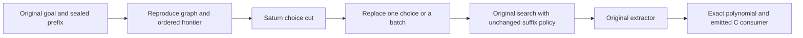

# Localizing a math search failure

The automated debugger finds a repair at the second rewrite round of the expanded scalar product. Replacing one of V2a's eight choices with a V1 proposal can reduce final arithmetic DAG cost from **9 to 5**, with the original V2a policy running every later round. The resulting expression compiles to **11 C instructions instead of 15**, and preserves both the exact polynomial and all tested numerical outputs. [Verified evidence](evidence/math-causal-20261107/README.md).

This is a bounded repair of a frozen scorer operating on the supplied V1 rule library. It identifies a consequential decision and useful replacements. It does not identify a unique faulty neuron, establish the full V2a system's behavior, or train a generally better scheduler.

## Capturing and editing the decision

`tools/math_debugger.py` wraps the original equality-saturation engine in a Saturn public adapter. A StateCut contains the input/context identity, the complete ordered prefix of decisions, the current frontier identity and the current ordered choice. Only `choice` is writable. Every choice must retain its length, contain unique candidate addresses and belong to the captured frontier.

The cut is a replay capsule. Reconstruction starts from the original goal and reruns the original matcher, feature construction, rule applications and congruence rebuild. Before consuming each recorded decision it verifies the raw graph representation, ordered candidates, exact FP32 feature bytes and remaining budget. Candidate addresses include their frontier epoch, so an index from another graph cannot silently select a different rewrite. Graph witnesses preserve Python container iteration order without calling mutating `find` or canonicalization helpers.



The same host/C boundary as the [math intake](MATH.md) remains: the host owns FieldLM parsing and frames, rewrite semantics, features, graph mutation and extraction. C performs projected record filtering, frozen neural scoring and the emitted expression's numerical computation. Native lookups and source scores are separate audits; the search consumes C results.

Each arm retains the original limits: six rounds, at most eight selections per round, 48 selections in total, 768 nodes and 1,024 matches per round. Final extraction uses one pass and a 0.5-second budget. Prefix decisions consume the same logical budget when replayed. The scalar goal uses 46 selections because its first frontier has only six candidates.

The matcher and extractor have real clock limits. Each replay records a conservative proof that its wall time stayed below the earliest applicable threshold; otherwise it remains potentially timing-confounded. Cost reductions remain visible either way. A repair is qualified separately by exact function preservation and clocks proven unhit. All recorded attempts in the final panel satisfy those conditions.

## The second round opens the cheaper route

The goal is the eight-term expansion of `(x0+y0)*(x1+y1)*(x2+y2)`. Both C policies choose the same first batch. At the second frontier there are 42 candidates. V2a chooses eight two-term factorings. V1 proposes six four-term factorings and two two-term factorings on that exact recipient graph.

The debugger scans every reached baseline boundary; it does not assume an early repair remains useful later. The table uses human round numbers; raw records use zero-based indices.

| Round receiving the V1 batch | Final cost with the V2a suffix | Change from baseline cost 9 |
| --- | ---: | ---: |
| 1 | 9 | 0 |
| 2 | 5 | −4 |
| 3 | 6 | −3 |
| 4 | 11 | +2 |
| 5 | 11 | +2 |
| 6 | 11 | +2 |

The earliest tested repairable boundary is round 2. Its graph witness first differs at the next decision boundary, after the edited batch has been applied. Later substitutions can hurt, even though the same donor policy is useful earlier.

At round 2, the selected batches are disjoint. All 64 exchanges between their eight recipient and eight donor choices are tested. Each exchange replaces exactly one slot and preserves the other seven choices and their application order.

| Final cost after a single exchange | Number of exchanges |
| --- | ---: |
| 5 | 48 |
| 7 | 14 |
| 9 | 2 |

One concrete repair replaces recipient candidate 0 with donor candidate 2, a four-term factorization. The unchanged suffix reaches a fully factored product of the three sums. Doses of one, two, four and eight replacements all reach cost 5 in the declared slot order. These doses are observations of this coherent replacement sequence, not an exhaustive coalition search.

Grouping the exchanges by inserted candidate sharpens the mechanism: each of the six four-term factorings reaches cost 5 in all eight replacement slots. Each two-term donor reaches cost 7 in seven slots and cost 9 in one. The 48 strongest repairs therefore follow the broader factoring family across all tested slots.

## Controls distinguish a useful edit from arbitrary divergence

All 18 untouched, sham and A→B→A restoration controls reproduce the baseline endpoint exactly. Reversing the selected order at each of the six boundaries leaves final cost at 9. An alternative batch outside both selected sets, and eight single alternatives outside both sets, also leave cost at 9. Those alternatives are deterministic controls rather than a representative random sample of all possible batches.

Both policies have the same second-round frontier, allowing a direct comparison of the choice and later policy:

| Second-round choice | V1 suffix cost | V2a suffix cost |
| --- | ---: | ---: |
| V1 batch | 5 | 5 |
| V2a batch | 5 | 9 |

The reciprocal experiment installs V2a's proposal and runs the V1 suffix. It still reaches cost 5. Thus this is a repair opportunity: a broader early choice or the later V1 policy can recover the cheaper program. The second-round V2a choice is not an irreversible loss of mathematical information.

The planted scalar goal stays at cost 3 across all six batch substitutions. The ordered-matrix goal stays at weighted scalar cost 20 across its three reached decision boundaries. These controls preserve the distinction between changed execution and a worse final program.

The working inference is that this V2a ranking on the V1 library misses factorings that make a cheaper later route accessible under the bounded search. The useful replacements, unchanged order controls and ineffective tested alternatives support that explanation. The reciprocal recovery and harmful later swaps keep the conclusion local to the parent, choice and suffix policy.

## Numerical and execution evidence

The final panel retains 117 intervention/control branches, six baselines and 140 total reconstructions. All endpoints preserve the exact supplied polynomial. All 28 distinct emitted numerical programs match their source FP32 observations exactly, and every before/after pair has zero observed C output difference on 32 bounded integer rows. The matrix controls use the frozen exact learned811 cell.

All 558,535 logical FieldLM reads agree with the native reader. There are 64,196 unique projected queries and 616 distinct scorer batches. Maximum native/C score error is `4.57763671875e-5`; two frontier/version comparisons reorder choices inside the same selected set, with zero selected-set changes. This is **score error**, separate from the [PAN and Mamba vocabulary-logit errors](../../docs/SUPPORTED-MODELS.md#measured-logit-error).

The audit performs 64,840 physical C invocations for 142,672 logical C requests. Reuse requires the same executable/numerical profile, complete bundle bytes, input shape and input bytes. Native auditing, prefix reconstruction, extraction and physical calls remain charged outside the restored state. The worker takes 196.49 seconds; scheduler elapsed time is 206.00 seconds, including evidence packaging. Peak RSS is 822.7 MB. mrun admits one CPU worker with a 4,096 MB default probe reservation, four reserved cores and one arithmetic thread, a 600-second timeout and no retries. This instrumentation is not a serving speedup.

## Run and extend the debugger

```sh
rtk proxy ../common/bin/common exec python tools/math_fleet.py submit --mode math-causal
rtk proxy ../common/bin/common exec python tools/math_fleet.py collect JOB_ID
rtk proxy ../common/bin/common exec python tools/verify_math_causal.py results/JOB_ID \
  --output results/JOB_ID/verification.json
```

The causal panel explicitly opts into a 256 MiB expanded evidence limit. The collector reads that authority from the retained local submission; a remote report cannot raise it. Ordinary intake panels retain their 64 MiB limit. Source files, checkpoint hashes and the four public Saturn SDK files are pinned in the shipped payload.

`ReplayEngine` accepts a reviewed original graph engine, feature function, index, scorer and numerical consumer. Adding another compatible goal needs an expression and domain declaration; the capture, parent checks, interventions, suffix replay and evidence export are shared. Another model family still needs its own declared state closure and consumer adapter. Fresh-process restoration is not established by these same-process replays.

`verify_math_causal.py` checks the staged/executed source custody, immutable witnesses, feature bytes, C-derived proposals, budget accounting, exact polynomials and numerical consumers without running a learned model. It independently derives DAG costs with structural CSE, checks emitted binary instruction counts, and binds each emitted expression/domain/input order to its endpoint. It reconstructs Saturn cut fingerprints through every choice edit and continuation, and joins C inputs/outputs to the memo and physical invocation ledger. It preserves signed outcomes and branch errors separately from mechanics and instrument status.

The next discriminating experiment is a matched-budget set of new scalar goals with the same choice intervention policy. The current evidence supplies repair examples and failure contexts for that study; it does not authorize a training update or automatic scheduler promotion.
