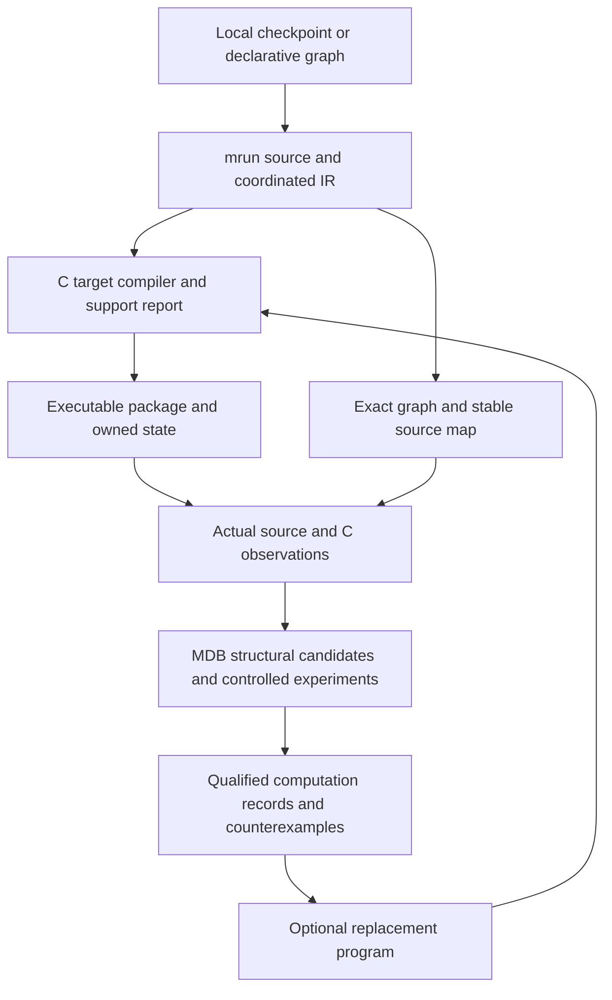

# Automating model execution and computation discovery

Date: November 6, 2026. Status: architecture proposal with an implemented offline structural intake prototype. Astra reviewed the existing discovery and compiler boundaries. No new numerical model execution or autonomous semantic-discovery result is claimed.

## The decision

Build one intake pipeline around the existing canonical model IR, a cmachine target compiler and an attached discovery controller. Make executable support independent of whether a computation has a semantic interpretation. A new model should arrive with its source identity, graph, numerical contract, state/IO contract, target coverage and an explicit list of unanswered questions.

The practical unit of manual work should become a new primitive, numerical profile or state contract. A new checkpoint using supported semantics should not require another handwritten model implementation or a complete semantic investigation before it can run.

This is two connected engineering jobs: compile trustworthy numerical execution, then automate investigations of that execution. Recording a tensor trace, recognizing an architecture, qualifying a C executor and identifying a meaningful computation are separate outcomes.

## Existing machinery to connect

| Owner | Reusable implementation | Current boundary |
| --- | --- | --- |
| mrun | [Source compiler](../../../mrun/src/mrun/decompiler/compiler.py), [coordinated IR](../../../mrun/src/mrun/decompiler/ir.py), [component emitter](../../../mrun/src/mrun/decompiler/emitter.py) | Registered adapters freeze declarative sources and cover weights, graph, state and IO. U2 decoding and source-range emission do not certify target execution. |
| manalysis | [Decompiler bridge](../../../manalysis/src/manalysis/decompiler_bridge.py) | Builds exact source-bound graph references and separate name/shape role priors. Priors are hypotheses, not learned semantics. |
| MDB | [Automatic forward recorder](../../../saturn-pub/packages/mdb/src/mdb/forward_recording.py), [structural catalog](../../../saturn-pub/packages/mdb/src/mdb/discovery_catalog.py) | Captures actual ATen operations and def-use. Pattern recognizers nominate structural scopes; they are supplied recognizers. |
| MDB and Saturn | [Discovery workflow](../../../saturn-pub/packages/mdb/docs/COMPUTATION-DISCOVERY-WORKFLOW.md), [qualification](../../../saturn-pub/packages/mdb/qualification/DISCOVERY-UPGRADES-VALIDATION.md) | Selected cuts, replay, interventions, native consumers and durable evidence work on bounded specimens. A recorded path is not a universal new-input program. |
| mrun compiler | [Typed operation graph](../../../mrun/src/mrun/compiler/graph.py), [WorkPlan](../../../mrun/docs/WORKPLAN.md) | Existing SSA, effect, slicing, liveness, preparation and scheduling concepts should be reused. Current backend qualifications do not imply a C target or general stateful support. |
| cmachine | [Bundle exporter](../../tools/bundle.py), [C architecture](../../docs/ARCHITECTURE.md), [capabilities](../../docs/CAPABILITIES.md) | C executes the nominated R3 and Qwen2.5-1.5B profiles. The exporter and runtime deliberately enforce fixed geometries and numerical semantics. |

MDB's `ATenStepper` recomputes exact recorded roots, requires their hashes to match and runs Torch operators. `ReplayForward` adds state control and edits to produced, live, unconsumed values. Neither is currently a general ATen-to-C compiler. The supplied source factory and architectural continuation still matter. Mutation and seeded randomness are outside that recording path's current contract.

The symbol pipeline also has important boundaries: source proposals require a supplied vocabulary, lifecycle joins require a registered exact binding, and the current [applicability evaluator](../../../saturn-pub/packages/mdb/src/mdb/computation_applicability.py) is bound to particular Qwen packets and a numerical profile. Reuse its source-only decision principle; do not treat that implementation as a generic semantic dispatcher.

## Three products with separate authority

The executable package owns the operations, parameter bytes, tensor views/aliases, numerical profile, public inputs/outputs and mutable state. It can run while meaningful roles remain unknown.

Execution evidence owns actual input/state values, observed runtime/device/library facts, clocks, consumed operands, writes and outputs. It must distinguish declared metadata from measured backend behavior.

Computation records own proposed or established relationships: represented variable, producer, source/address, carrier trajectory, writer, consumer, intervention, domain, horizon, signed effects, collateral and exceptions. Semantic hypotheses can guide an experiment; they cannot silently authorize a replacement.

## Preserve the right identities

Maintain three identities and explicit joins:

1. Source and executable-package identity: checkpoint, canonical IR bundle, code/weights, codecs, target compiler and actual numerical implementation.
2. Structural program identity: reusable operation graph, control/shape guards and parameter bindings. Its meaning is not established by a module name.
3. Execution occurrence: exact input, parent state, clock, route, current library revision and produced result.

Use existing `mrun://ir/<bundle>/...` references for the exact graph and existing MDB program/occurrence IDs for recordings. A source map joins the namespaces; it must not assert equality merely because two values have the same shape. Semantic labels remain annotations beside those identities.

One observed Python branch is one path. Python scalar extraction, shape specialization, dynamic control flow, aliasing or hidden effects must not become unrestricted generated C. Preserve a source-level contract or export guards that delimit the admitted input region.

## Import and lower numerical execution

For a known architecture, use the registered mrun adapter to create `ModelIR`, `PhysicalWeightIR`, `StateIR` and `IOIR`. A target lowerer checks each declared operation, view, codec, attribute and state transition against a versioned C support table. Reuse original parameter bytes and canonical source identity; preserve logical aliases, biases, normalization constants, RoPE convention, masks and output/token mappings.

The first target should reuse the existing Qwen2.5 C implementation. Generate its mapping and configuration from the canonical artifact, then apply the existing strict profile checks. A different checkpoint within supported semantics is the first generalization target. Another width or layer count is supported only after the hard-coded restrictions and implementation assumptions are genuinely removed and qualified.

The second target should be a small operator-driven C program for the bilinear cell and neural scorer. Those graphs need different compositions but share a small kernel library: linear maps, elementwise multiplication/addition and activation. Importing a second graph should require data and a valid contract, not another per-model C branch.

Do not force tensor programs into fake language-model metadata. `ModelDimensionsIR` currently retains vocabulary-oriented requirements. Reuse the existing typed operation/effect representation and make a deliberate additive canonical schema extension for stateless tensor programs if needed. Keep that evolution in mrun rather than creating another competing model ontology inside cmachine.

Stateful execution follows with explicit effects: initialization, append/update, logical position, valid-prefix ownership, commit/abort, rollback and reset. A recurrence is not just an array output. Include convolution history, scan state, K/V occupancy, pending output and RNG state whenever present. Only then claim continuation beyond a single imported call.

Target-specific optimization comes after a faithful baseline. Count original and derived work, compilation, parameter residence, transfers, state storage and replay. A full explicit implementation can be useful before it is smaller or faster.

## What happens when something is unknown

| Unknown | Required behavior |
| --- | --- |
| Semantic role | Retain a generic address and explicit unknown; continue qualified numerical execution. |
| Operator/schema/codec | Retain inventory and supported graph portions; emit a precise unsupported target report. |
| Numerical implementation | Qualify the actual backend/profile before making the corresponding numerical claim. |
| Mutation, alias or state ownership | Require an explicit effect/state contract before continuation. |
| Randomness | Declare RNG state and consumption order, or refuse replay under that contract. |
| Shape/control-flow region | Record the guards and reject or explicitly recompile outside them. |
| Foreign model code | Use a reviewed importer or an explicitly isolated import route; hashes alone do not make arbitrary source execution safe. |

An optional framework reference may run in the research worker, with its calls and cost recorded. It must never be hidden inside a claimed C-only executor. A failed approximation does not invalidate the supported reference model or erase completed evidence.

## Automate the investigation loop

Start with the imported graph and existing raw evidence, not an attempt to name every neuron. The controller should propose the next small discriminating experiment within a finite declared budget:

1. Inventory the recurring skeleton, direct dependencies, state effects and output consumers. Reuse source records and saved captures before requesting new forwards.
2. Nominate candidates using explicit algebra, repeated subgraphs, liveness, empirical contrasts and supplied recognizers. A GELU recognizer does not establish coverage for arbitrary SwiGLU; the recognizer's scope is part of the record.
3. Capture one complete parent and qualify unchanged replay at the required boundary. Declare native, sham, candidate and controls matched to the hypothesis; share physical work where compatible.
4. Predict a complete chosen boundary or response before its target runs. Form each candidate's live operands from the state it actually has, and distinguish paid observed operands from cheaper own-state formation.
5. Continue through the actual consumer. Measure local error, target/collateral behavior, repair and later state. After divergence, each branch continues with its own outputs and memory.
6. Preserve signed results, counterexamples, instrument failures and scope. Exact algebra may certify an identity; a few successful interventions establish only their declared causal/transfer evidence.
7. Choose the next uncertainty: source selection, argument binding, producer, carrier, receiving state, consumer or continuation. Expand context/seed/model coverage when it resolves a consequential ambiguity, not merely to accumulate a larger table.
8. Register a reusable program only with its source/shape/profile/clock/state guards. Applicability must be decided from available source conditions, not test outcomes. Retrieval scores nominate candidates; they are not execution authority.

The controller can use deterministic templates first, then an advisor or learned policy to select experiments. Test its choices against ordinary bounded breadth and heuristics. Preserve the cost of proposing, checking and selecting experiments. Human task definitions and evaluators remain supplied inputs until their acquisition is separately established.

The [existing concept-growth results](../../../model-experiments/experiments/2026-11-02-concept-graph-v2a/RESULTS.md) are a useful warning: a library-scorer pair that improves one family can harm another. Store both revisions, retain prior configurations and expose interference rather than hiding it behind one aggregate score.

## A simple interface and a staged delivery

The desired future interface is source import, target run and optional discovery with a bounded task specification. It should generate its own support/refusal report and evidence directory. These are product goals; the current executable prototype provides only the first offline structural step described below.

| Milestone | Deliverable | Evidence required |
| --- | --- | --- |
| 0 Implemented prototype | One offline command joins mrun import and manalysis exact graph/prior generation. | Tiny synthetic source/IR mechanics; no forward or C execution claim. |
| 1 Existing native target | Canonical artifact to existing C Qwen package with generated bindings, support table and source map. | Parameter/view coverage, original-profile checks, fresh source/C boundaries, own-output generation and state lifecycle. |
| 2 Different small graphs | Generic C numerical execution of the bilinear cell and scorer without separate model-name branches. | Independent source comparisons, new inputs, exact-domain certificates where applicable and output-dependent continuation. |
| 3 Bounded discovery worker | Automatically recorded observations, candidate scopes and a small same-parent experiment panel. | Native consumer, sham/wrong-site controls where informative, retained counterexamples and complete physical-work account. |
| 4 Reusable computation packages | Guarded laws and source resolvers tested on new contexts/checkpoints. | Independent applicability, fresh-process execution, actual next-state consumption and economic accounting. |

Before a new real-model worker is designed or launched, follow mrun's [API](../../../mrun/docs/API.md) and [WorkPlan](../../../mrun/docs/WORKPLAN.md) contracts. Use one finite strict-preflight lease, one model load, compatible in-process branches and no automatic retries/nested jobs. Only tiny synthetic mechanics stay local. CUDA work requests CUDA admission. Runs expected over 15 minutes receive the required independent Luna code/settings review.

During discovery, only integrity, instrument validity and safe continuation stop an invalid row. Report `mechanics_status`, `instrument_status`, `trend_status` and `terminal_status` separately. Apply terminal certification only to the bounded execution, mathematical, capability or timing claim actually being made.

## What the prototype does now

[`intake.py`](intake.py) accepts a local checkpoint source or an existing canonical IR/report. It emits normalized input, exact graph, hypothesis-only role priors, operation inventory, coordinated state/IO contracts and a readable report. Unknown families keep the canonical refusal. Existing outputs and output inside the frozen source are refused. Every operation remains `not-qualified-by-this-intake` for a C target.

Its tests use tiny inert Qwen2/Qwen3 source fixtures and no numerical model calls. The prototype does not bridge observed MDB traces into a new-input program, compile C or claim that a model has been understood. It makes the stable data spine executable so the next work is the missing target compiler and observation/source-map join, not another source-inventory implementation.

## Remaining human effort and success criteria

People still supply the initial task/consumer contract, review novel operators and effects, choose acceptable numerical behavior and authorize costly research expansion. The pipeline should remove repeated checkpoint bookkeeping, source mapping, common instrumentation, branch setup, evidence joins and tests for already supported semantics.

Measure reduced bring-up work directly: handwritten changes per new checkpoint, primitive families needing extension, unsupported cases diagnosed automatically, time to a qualified first output and stateful continuation, and the fraction of computation records that transfer without manual rebinding. Measure semantic and capability gains through new consumer tasks, independently of those engineering metrics.

The near-term result should be a second model imported through the same source-to-C path with no handwritten tensor mapping, plus an automatically produced graph and honest unknowns. General autonomous understanding remains a research target, while simple execution of supported new models becomes an engineering deliverable.
