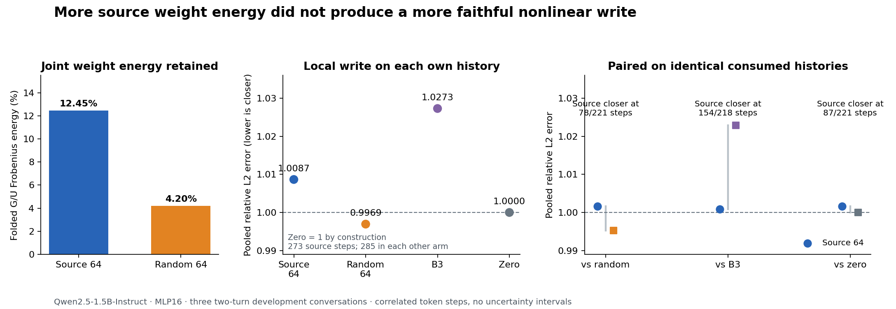
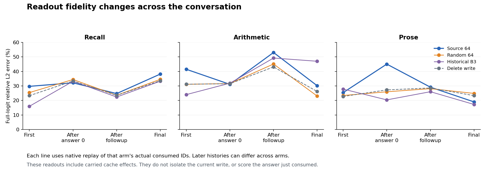

# Source weight energy did not preserve the nonlinear write

November 6, 2026. Completed exploratory Qwen2.5-1.5B-Instruct C FP32 CUDA/cuBLAS experiment at MLP16. Main job `job-51df6b792d28`; report SHA256 `e5d23802467bd705ef6e1d9ea7e3dd8925f52589d0dd2942c325404e171a59b7`. The [prospective plan](PLAN.md), [executed report](runs/job-51df6b792d28/report.json), [verification](runs/job-51df6b792d28/verification.json), [independent audit](runs/job-51df6b792d28/AUDIT.md) and [Astra review](RESULTS-ADVISOR.md) preserve the full contract.

## What the panel establishes

A source-only rank-64 operand program replaces both original selected gate/up maps from the first prompt token through generated tokens, later user/template ingestion and a second answer. Actual-call instrumentation records zero original selected G/U calls in every primary policy. That removes the native-prefix bootstrap and target-calibration dependencies from this particular compiled operand program.

The approximation does not earn a general native-write reconstruction advantage. It captures 12.4482% of the joint folded source operator's energy versus the random control's 4.2013%, yet its pooled local write error is 1.008661 times native-write norm, slightly worse than deletion's 1. On matched consumed histories it loses to random64 at 143/221 paired steps. Correct recall answers survive every policy, including deletion. The source program produces correct multiplication 391 followed by incorrect subtraction 357; zero and random produce a continuation beginning with the correct subtraction 367. These are bounded observations on three development conversations, not evidence against all low-rank or source-derived programs.

Mechanics and instrument status are complete; scientific results are observations with heterogeneous trends. Terminal certification was not requested. No metric is used as a discovery stop or promotion rule.

## The executed computation

For actual raw post-attention receiver r, learned scale Γ=diag(gamma), and native scalar RMS inverse rho(r), the native MLP is, in real arithmetic,

\[
g=\rho(r)G\Gamma r,\quad u=\rho(r)U\Gamma r,\quad M(r)=D[\operatorname{SiLU}(g)\odot u].
\]

Set A=GΓ and B=UΓ. Compile one approximate right singular subspace of the joint operator [A;B], rank64, oversample16, two power iterations, seed20261106. The matched random control is a Gaussian QR basis of the same rank, seed20261107. Neither basis uses activations. The source basis is randomized, not an exact truncated SVD or a proof of the optimal rank-64 consumer program.

At each token, the source/random programs execute

\[
z=Q^\top r,\qquad \widehat g=\rho(r)(AQ)z,\qquad
\widehat u=\rho(r)(BQ)z,\qquad
\widehat M=D[\operatorname{SiLU}(\widehat g)\odot\widehat u].
\]

The stored Q is FP32. Images AQ/BQ are compiled in FP64 from the exact emitted Q bytes, then cast FP32; the manifest retains both basis and image cast effects. Native normalization, exact existing scalar nonlinear/product kernel and dense down projection remain. Native `(r*rho)*gamma` and folded factors have different finite operation order, so this equation is an approximation with an explicit numerical profile.

Four primary policies are source64, random64, unchanged historical B3 and zero. B3 retains its historical activation calibration and is not a matched source-only control. All policies apply from the first input token, with no refreshed anchors or fallback. Each primary path owns its generated IDs, full K/V and subsequent inputs. Three two-turn cases cover badge recall/correction, arithmetic and short explanatory prose, with a 16-token budget per answer. Every delivered token, including EOS or a final budget token, is consumed once. All twelve paths and their factor identities are sealed before native comparisons.

## Clean common-history mechanics

The main panel contains 273 source64, 285 random64, 285 B3 and 285 zero steps: 1,128 primary token transitions. Source64 stops its arithmetic followup early. Independent raw-array comparison finds byte-exact raw receivers and normalized MLP16 inputs against native same-ID replay at **all 1,128 steps**. The lower computation therefore provides the declared actual operands on identical consumed histories. This does not imply equality of upper-layer historical K/V or readouts.

An independent seal audit authenticates 4,638 primary files and all six compiled factor files, checks 27 token records without an authority mismatch, and checks the complete capture geometry. The archived analyzer independently recomputes on the Mac. Scheduler/log/payload verification authenticates 81 source files, 9,332 raw files, the executed binary and the whole-invocation Saturn receipt. That receipt describes a process boundary; it is not an internal C/CUDA trace of every operation.

The producer and independent audit both find 285 groups shared by at least two primary paths. The stricter intersection shared by all four primary policies contains 218 groups. These are different inclusion rules, not additional independent samples.

## Local write results

For each candidate receiver, a paid, post-seal native MLP evaluation supplies the reference write. Define pooled error

\[
E=\sqrt{\frac{\sum_t\|\widehat M_t-M_t\|_2^2}{\sum_t\|M_t\|_2^2}}.
\]

Deleting the write gives E=1 by construction. Own-history aggregates have different receiver distributions after token divergence.

| Policy | Steps | Pooled E | Per-row errors below zero | Mean candidate/native write norm |
| --- | ---: | ---: | ---: | ---: |
| Source64 | 273 | 1.008661 | 88/273 | 0.3872 |
| Random64 | 285 | 0.996941 | 163/285 | 0.1549 |
| B3 | 285 | 1.027298 | 23/285 | 0.2895 |
| Zero | 285 | 1.000000 | Equal by construction | 0 |

| Identical-history comparison | Paired steps | Source lower error | Source pooled E | Comparator pooled E |
| --- | ---: | ---: | ---: | ---: |
| Source vs random | 221 | 78 | 1.001577 | 0.995234 |
| Source vs B3 | 218 | 154 | 1.000882 | 1.022933 |
| Source vs zero | 221 | 87 | 1.001577 | 1.000000 |

The source basis improves on B3 on this paired local metric, but does not establish an advantage over matched random or deletion. Its arithmetic-case pooled error is slightly below zero at 0.999656; recall is 1.009472 and prose 1.017726. The 88 individually improved source writes and this near-zero case remain part of the result. Correlated token transitions across three conversations do not justify independent-sample confidence intervals.

At the twelve selected operand clocks per nonzero arm, source64's mean gate/up relative errors are 0.6715/0.9402 versus random64's 1.0002/1.0197. Smaller separate operand errors did not rank the nonlinear write. Random also emits much smaller writes, so its better error may partly reflect remaining closer to deletion. There is no output-norm-matched control that establishes useful random semantics.

## Own-token behavior and later readers

| Policy | 17 × 23 answer | Followup subtraction answer |
| --- | --- | --- |
| Native | `401` | `157. The result of 401 minus 24 is` (budget truncated) |
| Source64 | `391` | `357` (EOS; requested explanation absent) |
| Random64 | `391` | `391 - 24 = 367. Subtracting ` (budget truncated) |
| B3 | `391` | `391 - 24 = 367. Calculation: Subtract` (budget truncated) |
| Zero | `391` | Same delivered IDs as random64 |

Native multiplication is incorrect; 391 is correct. Source64 then subtracts incorrectly: 391−24=367. Native's followup is also wrong even relative to its own answer: 401−24=377. Matching native computation and solving the task are distinct objectives. Source64's shorter stopped answer is not a matched-completion compute saving.

All five policies return blue then green in recall. Random and zero deliver identical answer IDs across the entire three-case panel, including prose. All prose answers hit the budget; their fragments do not establish completed explanation or general chat quality. The [independent summary](runs/job-51df6b792d28/advisor-independent-summary.json) retains exact text.

Four full-vocabulary readout clocks are initial prompt completion, after consuming answer0, after ingesting followup, and after consuming answer1. The candidate C is compared with native replay H of its own actual consumed IDs; a separate native-own N follows its own text. The report preserves C−H, C−N and N−H. C−H includes replacement plus carried-cache effects and is not a pure current-write defect.

Source64 arithmetic C−H relative logit errors are 41.46%, 31.08%, 53.02% and 30.14%, versus zero's 31.17%, 31.51%, 43.08% and 26.16%. Source improves slightly at the post-answer0 boundary. It also improves final prose error, 18.98% versus zero's 23.31%, while its post-answer0 prose error worsens, 45.02% versus 27.26%. Each uses its correct native same-ID denominator; later histories differ across policies. Greedy recall decisions agree despite substantial full-vector differences.

## What the math points toward

For any predicted write,

\[
\|\widehat M-M\|^2=\|M\|^2+\|\widehat M\|^2-2\langle M,\widehat M\rangle.
\]

A larger candidate write beats zero only if twice its alignment with the native write exceeds its own squared norm. Capturing more source energy does not ensure this alignment after nonlinear channel conjunction and down projection.

With s=SiLU(g), shat=SiLU(ghat), δs=s−shat and δu=u−uhat, the exact real-arithmetic identity is

\[
M-\widehat M=D[\delta s\odot\widehat u+\widehat s\odot\delta u+\delta s\odot\delta u].
\]

Thus a useful representation depends on which gate/up errors interact and which directions D and later readers consume. This identity motivates a causal experiment; it does not assign measured shares to these terms in the current panel. Native finite arithmetic requires retaining the reconstruction remainder.

The smallest proposed next cut restores gate and up separately at a common retained parent: Y00=D[SiLU(ghat)uhat], Y10=D[SiLU(g)uhat], Y01=D[SiLU(ghat)u], Y11=D[SiLU(g)u]. Its interaction is

\[
Y_{11}-Y_{10}-Y_{01}+Y_{00}=D[(\operatorname{SiLU}(g)-\operatorname{SiLU}(\widehat g))\odot(u-\widehat u)].
\]

This identity applies to the four writes before the suffix. For suffix outputs Z_ab=F_parent(Y_ab), the measured interaction Z11−Z10−Z01+Z00 generally differs from that write-space expression because the suffix is nonlinear. Use fixed representative clocks and the same native suffix; treat the first differing arithmetic digit as an explicitly retrospective localization. Native control operands are paid diagnostic inputs and cannot feed a source-only candidate. If current restoration leaves the readout defect, separately contrast accumulated cache. A single restored write cannot establish repaired autonomous recurrence. This factorial has not run.

## Work and resources

The original selected G/U pair costs 27,525,120 nominal MACs per token. The rank-64 projection plus two images cost 1,245,184, removing 26,279,936: approximately 1.70% of the native whole-token learned-linear count of 1,543,569,408. Three derived matvecs replace two original matvecs, so raw call count increases from 197 to 198 while geometry shrinks. The dense down map, native normalization, all other layers, attention, vocabulary readout and full K/V remain.

Each rank-64 program has 4,980,736 factor bytes; two banks total 9,961,472. Original weights stay resident. Source64 performs 273 each of Q/G-image/U-image calls; random64 performs 285 each. All primary selected original G/U calls are zero. Zero skips its down map as well. The complete job pays 2,541 full token computations: 1,128 primary, 285 native-own and 1,128 native same-ID. It additionally pays 1,128 standalone exact MLP diagnostics, source compilation and capture/hash/transport work.

Smoke job `job-23dd9b4d0de9` completed in 55.09 seconds with 4,148.6 MB RSS and 6,394 MB VRAM. Main job completed in 58.57 seconds with 4,031.1 MB RSS and 6,394 MB VRAM. These mixed-arm, compilation-and-diagnostic timings do not measure candidate serving speed. The smoke's two-token answers change later context and are a mechanics lane, not a separate complete arithmetic replication.

The C state machine continues to provide correct token authority, owned memory and inspectable computation boundaries. This cut improves our ability to test a cheaper operand program on its own states. Useful consumer-preserving operands, scalable state encoding and whole-model work elimination remain open.

## Evidence plane

The target-local [coverage record](index/job-51df6b792d28/coverage.json) binds 1,311 scalar observation rows: 1,128 local writes, 144 readout comparisons, 12 call ledgers, 12 token-authority records, 3 common-history summaries and 12 same-ID summaries. A separate probe stream retains 1,128 same-ID receiver/norm checks. Standard Saturn evidence run and verify both complete with no broken instrument or findings. [Sweep results](index/job-51df6b792d28/sweep-results.json) preserve their exact outputs and the target-stream-only scope. No new model call or scientific quality gate is introduced by this indexing. Full vectors and the original report remain authoritative.
