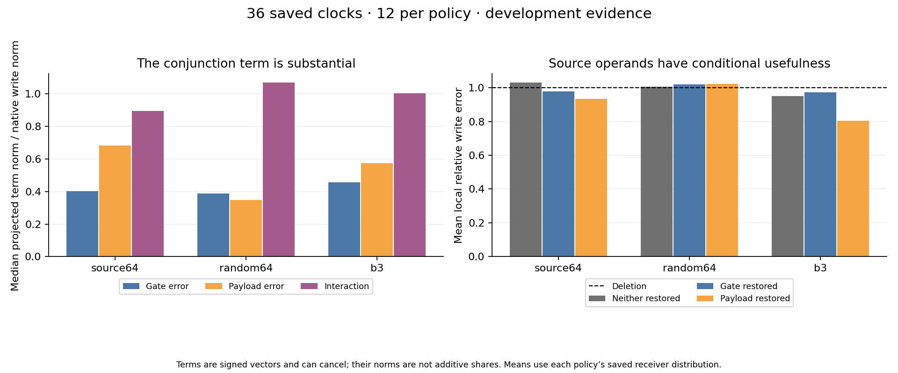
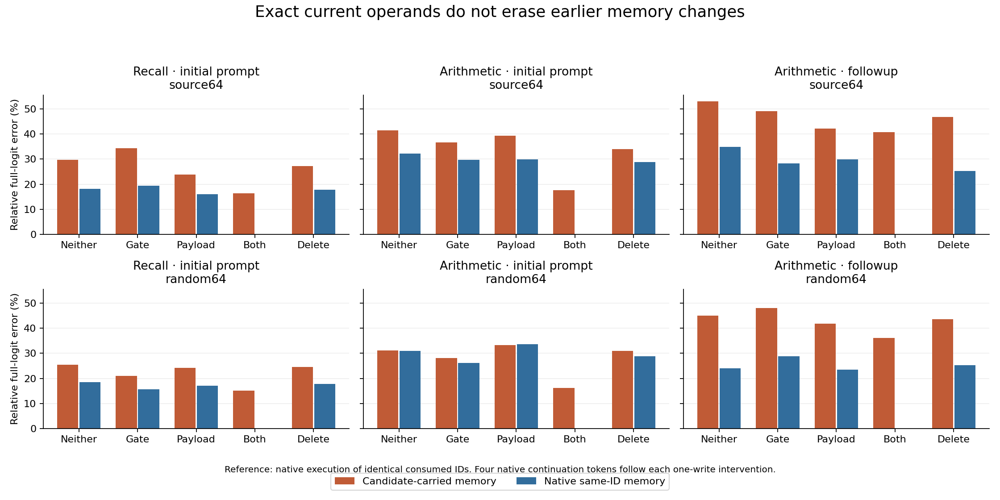

# Restored operands expose persistent memory differences

November 6, 2026. Completed exploratory job `job-1771ced3fed7`, Qwen2.5-1.5B-Instruct, original C FP32 CUDA/cuBLAS execution-v2 profile, MLP16. [Report](runs/job-1771ced3fed7/report.json) SHA256 `8b2e0171ead676b7d2df55ea3bff290cc60bb91bbcf36921e4b503de0c566346`. [Prospective plan](PLAN.md), [verification](runs/job-1771ced3fed7/verification.json), [independent array audit](runs/job-1771ced3fed7/independent-array-audit.json), [frozen payload](runs/job-1771ced3fed7/payload/).

## Outcome

The source64 gate/up errors have a substantial nonlinear interaction after down projection. Restoring either operand improves the local source write at every one of its 12 saved clocks. Yet even restoring both operands and the exact current native write leaves 15.05–40.81% full-logit discrepancy with candidate-carried memory. The paired native-same-ID memory parent reproduces exact native logits after the same current restoration.

This separates imperfect current operands from persistent historical K/V within the declared C execution. It also preserves a positive source-basis trend that aggregate write error concealed: its individual operands are conditionally useful. These are development cases and mechanism observations; general chat fidelity, a minimum model size, and task correctness remain separate questions. No terminal promotion was requested.

## Instrument and work

All 108 post-hoc replay/identity checks pass. These include ordinary-native versus both-restored write/logits/four-token continuation, repeated candidate replay, historical full-vocabulary readout reproduction, and five imported operand/receiver comparisons per parent. The C driver additionally checks the valid prefix K/V digest before and after every branch rollback. All 24 independently checked cross-parent current receivers, native gate/up operands and restored writes are byte-identical.

The algebraic panel reuses all 36 saved complete operand clocks in predecessor `job-51df6b792d28`: 12 each for source64, random64 and historical B3. The new causal panel uses six source64/random64 clocks: recall initial prompt, arithmetic initial prompt and arithmetic followup. Each reconstructs candidate-carried and native-same-ID history parents, then runs neither restored, gate restored, payload restored, both restored, deletion, ordinary native and repeated neither. This is 84 native-suffix branches, each followed by up to four native-generated tokens, including consumption of delivered EOS. The six clocks comprise three endpoints under two policies, not six independent tasks.

All branches pay native operands as diagnostics. After the single intervention, continuation uses native execution; it does not use recurring source64/random64 or establish autonomous repair. Original checkpoint files and serving runtime remain unchanged. The worker has a whole-invocation Saturn receipt; it is not an internal Saturn trace of every C operation.

## Signed decomposition

For native s=SiLU(g), candidate shat=SiLU(ghat), delta_s=s-shat and delta_u=u-uhat:

\[
M-\widehat M
=D[\delta s\odot\widehat u]
+D[\widehat s\odot\delta u]
+D[\delta s\odot\delta u]+\epsilon_{finite}.
\]

The down map is the exact original FP32 tensor, promoted to FP64 for analysis. The maximum finite reconstruction remainder is `8.073e-7` of native-write norm. An independent tanh-SiLU reconstruction of the actual four-write interaction gives maximum remainder `7.708e-7`. These are measured numerical qualifications, not scientific quality gates.

| Policy | Median gate-term norm/native | Median payload-term norm/native | Median interaction norm/native |
| --- | ---: | ---: | ---: |
| Source64 | 0.4019 | 0.6822 | 0.8961 |
| Random64 | 0.3869 | 0.3468 | 1.0702 |
| B3 | 0.4556 | 0.5758 | 1.0034 |

Terms are signed vectors. Their squared norms do not add to squared error without cross terms. Full signed Gram matrices and alignments are retained in the report, and projected vectors in [signed-projections.npz](runs/job-1771ced3fed7/raw/signed-projections.npz). A large interaction norm is not an independently attributable percentage or a proof that interaction is the sole failure.

## Conditional usefulness

The following are means of relative local errors over 12 sampled clocks per policy, using each policy's own saved receivers. They are not the predecessor's all-step pooled statistic, and different policies need not share all histories.

| Policy | Neither restored | Gate restored | Payload restored | Gate restoration improves | Payload restoration improves |
| --- | ---: | ---: | ---: | ---: | ---: |
| Source64 | 1.0305 | 0.9789 | 0.9349 | 12/12 | 12/12 |
| Random64 | 1.0057 | 1.0194 | 1.0219 | 2/12 | 3/12 |
| B3 | 0.9506 | 0.9712 | 0.8039 | 4/12 | 12/12 |

The small source write still loses to random in seven of eight sampled complete-history matched pairs. The arithmetic followup pair is the countertrend. Source's individually smaller operand errors therefore coexist with worse joint write fidelity on most matched clocks. Replacing one operand also changes the interaction term, so these restorations do not assign independent causal shares to gate and payload.

## Exact current repair versus historical memory

The reference in every row below is native execution of the same complete consumed IDs. The restored current receiver, native gate/up and consumed write are byte-identical across candidate-carried and native-memory parents. Native-memory/both-restored logits are exact at all six clocks.

| Endpoint | Policy | Neither restored, carried memory | Both restored, carried memory | Both restored, native memory |
| --- | --- | ---: | ---: | ---: |
| Recall prompt | Source64 | 29.70% | 16.42% | 0% |
| Recall prompt | Random64 | 25.40% | 15.05% | 0% |
| Arithmetic prompt | Source64 | 41.46% | 17.53% | 0% |
| Arithmetic prompt | Random64 | 31.11% | 16.20% | 0% |
| Arithmetic followup | Source64 | 53.02% | 40.81% | 0% |
| Arithmetic followup | Random64 | 45.09% | 36.08% | 0% |

These are relative full-vector L2 errors, not error probabilities. Within this runtime the remaining parent difference is historical K/V, including upper-layer memory written under earlier MLP16 approximations. It persists despite identical current operands. Readout differences cannot be assigned wholly to the currently inspected MLP write.

Gate restoration can improve a local write while worsening the consumer. Source64 recall improves local write error from 1.0220 to 0.9651, while carried-parent logit error grows from 29.70% to 34.41%. With native memory it grows from 18.07% to 19.39%. The unchanged answer remains blue. This is a concrete distinction among operand fidelity, write fidelity, full-readout fidelity and greedy behavior.

## Arithmetic fidelity is not truth

At the initial multiplication endpoint, carried-memory 00, gate-only and payload-only all begin a native continuation with `391`. Restoring both changes it to native `401` for both source64 and random64. Here 391 is correct and native 401 is wrong. All native-memory arms in that endpoint produce 401. The four-token continuation demonstrates a bounded change in the consumed computation; it is not an improved reasoning score.

At the arithmetic followup, restoring both still begins `357.` on carried memory, while native same-ID execution begins `357\n`. Those continuations use the same earlier assistant result 391 and ask to subtract 24, whose correct answer is 367. The original random64 recurring path's correct subtraction fragment does not carry over to a branch that switches future execution to native. Exact first readout replay remains verified.

## Implication and next cut

Source energy measures how well the two linear maps are represented globally. The consumed write depends on their nonlinear product, the down reader and current receiver. Later computation additionally depends on memory already written. A useful compression objective must address those coupled requirements; independently reducing gate/up weight error is insufficient in this specimen.

The smallest follow-up is to optimize or compare a coupled consumer-weighted operand program on admitted receivers, then test it from the first prompt token and measure its written K/V and own-state horizon. Keep one local repair, memory replacement and recurring repair as separate interventions. A same-geometry Base/posttrained weight-by-receiver experiment remains a distinct proposed cut; this job did not perform that checkpoint transplant.

## Resources and evidence plane

One mrun lease, no retries. Scheduler wall time 94.32s, worker computation/report preparation 32.69s and C driver 14.44s. Peak RSS 3,231.8MB and VRAM 6,394MB. Archive transport, original native diagnostics, full readouts and verification are paid. These timings are not a serving benchmark.

The verifier authenticates 352 frozen source/asset files, 679 raw files, scheduler-log/report joins, the executed binary and whole-invocation receipt. Saved-array analysis reproduces independently on the Mac with the declared FP64 reduction-order tolerance; native replay controls remain byte-exact. The [target-local evidence coverage](index/job-1771ced3fed7/coverage.json) indexes 36 decomposition, 84 consumer and 108 mechanics observations, totaling 228. Standard Saturn run and verify complete with return code 0. Full arrays and raw reports remain authoritative.
